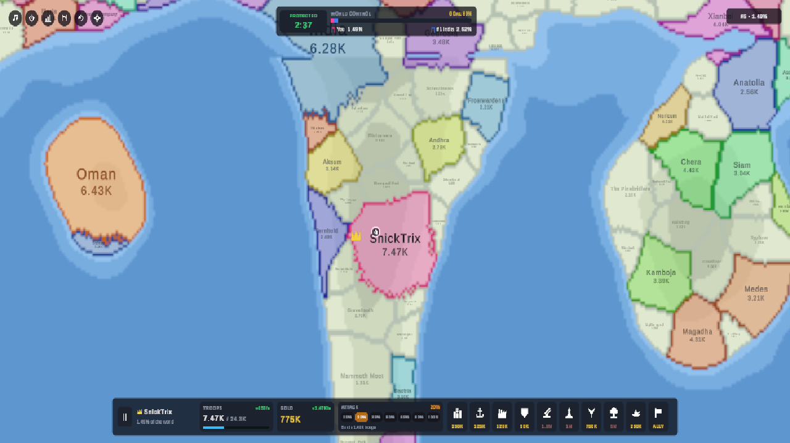

# MeWorld (RoWorld / OpenFront Clone)

> **Real-time Territory Conquest & World Domination RTS** built in Unity 6 (URP 2D).  
> Recreating the mechanics and visual style of **RoWorld [World PvP] (OpenFront / Territorial.io)** with 100% procedural art, procedural UI, autonomous AI nations, and tactical warfare.



---

## 🌍 Overview

**MeWorld** is a real-time grand strategy and territory conquest game. Players start as the ruler of a sovereign nation (e.g. **SnickTrix**) positioned in a contested world surrounded by 87 rival AI empires (such as **India**, **Oman**, **Fernhold**, **Frostwardens**) and over 110 independent regional tribes.

Your goal: **Expand your territory, manage your economy, build fortifications, research nuclear weapons, and conquer 80% of the world.**

---

## ✨ Key Features

- **100% Procedural World & Pixel-Buffer Rendering:**
  - Multi-octave Fractional Brownian Motion (fBm) Perlin noise generation combined with continental falloff masks.
  - High-performance 1D cell grid buffer (`560 x 320`) rendered onto a dynamic `Texture2D` via single batch `SpriteRenderer`.
  - Multi-source Breadth-First-Search (Voronoi Regional Tiling) eliminating void zones and producing natural, organic country borders.
  - Procedural country border coloring with high-contrast player borders (`#EC4899`).

- **88 Active Empires & 110 Autonomous Tribes:**
  - Full AI simulation featuring opportunistic expansion, border defense, defensive post construction, and retaliatory nuclear strikes.
  - Independent tribes feature muted visual hierarchy and defensive turtling behavior.

- **Realistic Macro-Economy & Logistic Growth:**
  - Non-linear logistic troop replenishment curve (peak growth at 35–50% capacity, tapering as capacity approaches the limit).
  - Gold economy scaling with controlled land tiles, built Cities, industrial Factories, and coastal Ports.

- **Frontier-Based Wave Combat & Naval Invasions:**
  - Adjustable Attack Ratio slider (`10%`, `20%`, `35%`, `50%`, `65%`, `80%`, `100%`).
  - Distance-sorted frontier expansion: Attacks focus on the precise border sector clicked by the commander.
  - Coastal landing and naval invasion mechanics for attacking overseas territories.

- **10 Strategic Structures & Nuclear Arsenal:**
  1. **City (250K Gold):** Expands maximum troop cap and baseline recruitment rate.
  2. **Port (125K Gold):** Establishes sea trade routes and enables cross-ocean naval invasions.
  3. **Factory (125K Gold):** Drastically multiplies gold generation (`+Gold/s`).
  4. **Defense Post (50K Gold):** Fortifies nearby friendly territory with a 2.5x defense multiplier against invading waves.
  5. **SAM Launcher (1.5M Gold):** Active aerial defense perimeter that detects and intercepts incoming enemy nuclear warheads in mid-air.
  6. **Missile Silo (1M Gold):** Requisite launch pad facility required to deploy nuclear strikes.
  7. **Atom Bomb (750K Gold):** Tactical nuclear strike destroying enemy defenses and turning target territory into neutral scorched wasteland (`Radius = 13`).
  8. **Hydrogen Bomb (5M Gold):** Strategic superweapon inflicting massive devastation (`Radius = 26`).
  9. **Warship (250K Gold):** Deploys naval patrol ships along coastlines for automated shoreline bombardment.
  10. **Alliance (Diplomacy):** Forges non-aggression and mutual defense pacts with neighboring sovereign states.

- **Faithful RoWorld HUD & World-Space Labels:**
  - Dynamic world-space country labels that automatically scale, fade, and sort based on camera zoom level.
  - Top World Control status pill displaying real-time dominance percentages and the initial `2:37` protection countdown.
  - Clean bottom control dock featuring procedural vector pictograms, troop/gold rate counters, and quick-action toolbars.

---

## 🎮 Controls

| Action | Control |
| :--- | :--- |
| **Pan Camera** | Middle Mouse Drag / Right Mouse Drag / `WASD` / Arrow Keys |
| **Zoom In / Out** | Mouse Scroll Wheel (Cursor-centered zoom) |
| **Attack Territory** | Left Click on neighboring enemy or tribe territory |
| **Build / Launch Nuke** | Select action from the bottom dock, then Left Click valid target tile |
| **Cancel Selection** | Right Click |
| **Pause / Resume** | Left Click the `||` button on the bottom-left dock |
| **Focus Capital** | Left Click the Crosshair icon on the top-left toolbar |

---

## 🛠️ Architecture & Tech Stack

- **Engine:** Unity 6 (`6000.3.21f1`)
- **Render Pipeline:** Universal Render Pipeline (URP 2D)
- **Input System:** Unity New Input System (`UnityEngine.InputSystem`)
- **UI:** TextMeshPro + Custom Procedural Sprite & Canvas Architecture
- **Zero External Dependencies:** Built entirely with native Unity packages and procedural algorithms. No 3rd-party asset or library bloat.

```
Assets/Scripts/
├── Core/
│   ├── GameConfig.cs               # Simulation constants, economy formulas, action costs
│   └── GameManagerAndBootstrapper.cs # Scene lifecycle, runtime initialization, tick loop
├── Map/
│   ├── WorldMapGrid.cs             # 1D high-performance grid, fBm Perlin generation, terrain
│   └── MapRendererAndCamera.cs     # Texture2D procedural pixel buffer & orthographic camera
├── Nations/
│   ├── NationModels.cs             # Data models for empires, tribes, attack waves, name pools
│   ├── TerritoryAndCombatManager.cs # Voronoi expansion, frontier combat, logistic economy
│   └── AIController.cs             # Autonomous AI state machines and decision trees
├── Structures/
│   └── StructureAndNukeManager.cs  # 10 building types, missile flight arcs, SAM interception
└── UI/
    ├── ProceduralSpriteFactory.cs  # Procedural vector sprites, badges, and icons
    ├── RoWorldHUDController.cs     # Main screen overlay HUD, control bars, docks
    └── WorldLabelsController.cs    # World-space dynamic country text and troop counters
```

---

## 🚀 Getting Started

1. Clone or download this repository:
   ```bash
   git clone https://github.com/mehmet7helvaci/MeWorld.git
   ```
2. Open the project in **Unity 6 (6000.3.x or later)**.
3. Open `Assets/Scenes/SampleScene.unity`.
4. Press **Play** in the Unity Editor to immediately launch the simulation.

---

## 📜 License & Credits

- Inspired by **RoWorld [World PvP]** and **OpenFront / Territorial.io**.
- Built with ❤️ by **Mehmet Helvacı**.
